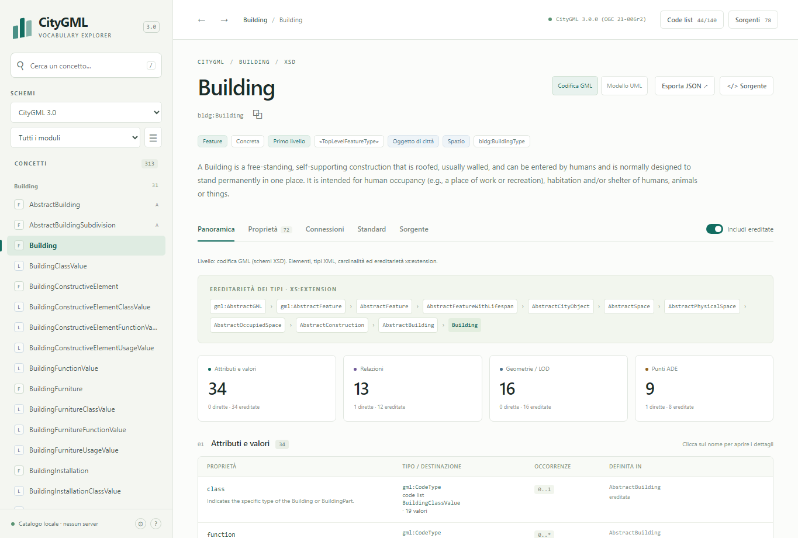

# CityGML 3.0 Explorer

Esploratore statico del vocabolario CityGML 3.0. Si cerca un concetto a
sinistra e se ne consultano a destra definizione, attributi, proprietà
geometriche, cardinalità, ereditarietà, relazioni, superfici di confine
ammesse, vincoli, requisiti e sorgente XML.

Il catalogo unisce le due parti dello standard OGC:

- **struttura** dagli schemi XSD ufficiali (CityGML 3.0 Part 2: GML Encoding,
  OGC 21-006r2): classi, attributi, cardinalità, ereditarietà, relazioni;
- **modello concettuale** dal documento OGC 20-010 (CityGML 3.0 Part 1:
  Conceptual Model) e dal suo modello UML: stereotipi, oggetti di primo livello,
  code list, generalizzazioni, attributi e ruoli, vincoli OCL, valori delle
  enumerazioni, superfici di confine ammesse, requisiti, composizioni;
- **regole di codifica** dal documento OGC 21-006r2: requisiti, raccomandazioni
  e classi di requisiti della codifica GML, collegati alle proprietà che
  nominano.

Lo standard non definisce i **valori delle code list**: li affida a dizionari
esterni. Il catalogo carica un **dizionario locale** modificabile
dall'interfaccia, inizializzato con gli esempi OGC delle code list: i valori
compaiono nelle classi che le usano e nella ricerca.

Funziona offline: nessun backend, database o CDN. Tutte le fonti necessarie sono
nella cartella `sources/`.

Da riga di comando il vocabolario in uso si esporta per tre destinatari: l'editor
di City3D, un generatore di file CityGML e una persona che vuole consultare lo
standard (vedi [Esportare](#esportare)).



## Aprire il catalogo

Aprire `index.html` con doppio clic. La pagina legge `data/catalog.js`, generato
dalle fonti in `sources/`; non servono server né connessione. I collegamenti ai
documenti OGC 20-010 e 21-006r2 aprono la loro copia locale.

### Ricerca e filtri

La ricerca trova classi, valori delle code list e nomi delle proprietà. Una
proprietà compare una volta, nella classe che la dichiara, anche se astratta; il
clic apre la scheda di quella classe con i dettagli della proprietà, compreso
l'elenco delle classi concrete che la ereditano.

I filtri scelgono il gruppo di schemi (CityGML 3.0, schemi importati, tutti), il
modulo e la categoria (oggetti di primo livello, oggetti di città, spazi,
superfici di confine, feature, oggetti, tipi di dato, enumerazioni, code list),
e se includere tipi tecnici, ADE hook e riferimenti esterni o solo le classi
concrete. Modulo, categoria e "solo concreti" selezionano le classi e non
nascondono le proprietà.

### Scheda di un concetto

| Vista | Contenuto |
|---|---|
| Panoramica | ereditarietà, attributi, relazioni, valori delle code list, superfici di confine, geometrie, vincoli, sottoclassi |
| Proprietà | tutte le proprietà, filtrabili per nome e per gruppo |
| Connessioni | superclassi, sottoclassi, sostituzione XML, collegamenti in uscita e in entrata |
| Standard | classe nel modello concettuale (superclassi, sottoclassi, membri, vincoli, membri di un `CityModel` che la ammettono), capitolo del modulo, superfici ammesse, requisiti di OGC 20-010 e di OGC 21-006r2 del modulo e globali |
| Sorgente | provenienza, dichiarazione XML Schema e suoi vincoli |

L'interruttore **Includi ereditate** aggiunge le proprietà delle superclassi,
ognuna con la classe che la dichiara.

Le classi con un tipo XSD e una classe del modello concettuale si leggono a due
livelli, scelti nella testata della scheda:

- **Codifica GML**: elementi, tipi XML, cardinalità ed ereditarietà dei tipi
  degli schemi;
- **Modello UML**: definizione, attributi e ruoli del dizionario dati di OGC
  20-010, con le molteplicità e le generalizzazioni del modello UML (XMI), quelle
  disegnate nelle figure del documento; dove il dizionario riporta un valore
  diverso, compare accanto con il badge **dizionario**. Per ogni membro, la
  proprietà XSD corrispondente quando gli schemi ne danno prova.

Il livello è nell'URL (`level=uml`; senza il parametro vale la codifica GML) e
resta nei collegamenti fra le schede. **Esporta JSON** salva la scheda con il
livello (`level`) e le sole proprietà di quel livello; per una code list
aggiunge i valori del dizionario locale (`localCodeList`), che non sono
normativi, con l'indicazione se sono già salvati.

I dettagli di una proprietà riportano le destinazioni nel contesto della classe
visitata: per `boundary`, le superfici che la tabella dei confini di OGC 20-010
ammette per quella classe, o il divieto; per ogni destinazione, gli elementi
concreti del suo `substitutionGroup`, che gli schemi ammettono come candidati e
che le regole del modello o della codifica possono restringere. Riportano anche
le regole di OGC 21-006r2 che nominano la proprietà.

### Opzioni

Il pulsante ⚙ in basso a sinistra apre le opzioni di visualizzazione: dimensione
del testo (dall'85% al 140%) e tema chiaro, scuro o del sistema operativo. Le
scelte restano salvate nel browser.

## Sorgenti

Ogni file è scaricato dall'URL ufficiale e salvato in `sources/<host>/<percorso>`,
con la stessa struttura dell'URL. Date di download: 16 ottobre 2026; per il
documento OGC 21-006r2, 19 ottobre 2026. La data di ogni file è in
`sources/manifest.json`.

### Schemi XSD

| Schemi | File | Versione | Origine | Pubblicazione |
|---|---|---|---|---|
| CityGML 3.0: 17 moduli, profilo `CityGML.xsd`, `codeListMetaData.xsd` | 19 | 3.0.0 (`xs:schema/@version`) | `http://schemas.opengis.net/citygml/` | 2023-08-02, OGC 21-006r2 |
| xAL 3.0 (indirizzi): `xAL.xsd`, `xAL-types.xsd`, `CommonTypes.xsd` | 3 | OASIS CIQ v3.0 cs02, con import di W3C XLink | `http://schemas.opengis.net/citygml/xAL/3.0/` | 2023-08-04 |
| GML 3.2.1 (`gml.xsd` e componenti) | 28 | 3.2.2 (`xs:schema/@version`, correzione OGC CR 12-092) | `http://schemas.opengis.net/gml/3.2.1/` | 2016-12-02 |
| ISO/TS 19139:2007 (`gco`, `gmd`, `gsr`, `gss`, `gts`) | 26 | 2012-07-13 | `http://schemas.opengis.net/iso/19139/20070417/` | 2012-07-13 |
| W3C XLink | 1 | — | `http://www.w3.org/1999/xlink.xsd` | 2008-12-03 (`Last-Modified`) |
| W3C namespace XML | 1 | — | `http://www.w3.org/2001/xml.xsd` | 2009-01-21 (`Last-Modified`) |

Le date di pubblicazione OGC provengono dai file `ReadMe.txt` del repository
degli schemi; il server `schemas.opengis.net` riporta per tutti i file OGC
`Last-Modified: 2025-04-09`. I 22 file CityGML e xAL coincidono con il
pacchetto ufficiale `http://schemas.opengis.net/citygml/citygml-3_0_0.zip`.

### Modello concettuale

| Fonte | Versione | Origine | Pubblicazione |
|---|---|---|---|
| OGC 20-010, *OGC City Geography Markup Language (CityGML) Part 1: Conceptual Model Standard* (HTML) | 3.0.0 | `https://docs.ogc.org/is/20-010/20-010.html` | approvato 2021-06-04, pubblicato 2021-09-13 (`Last-Modified` del file: 2026-04-24) |
| Modello UML CityGML 3.0 (XMI esportato da Enterprise Architect), file `XMI Files.zip` | 3.0 | repository OGC `opengeospatial/CityGML-3.0CM`, commit `71ec3bee28f6b883e543a4439a0732bd37e2d9ab` | 2021-08-02 |

Dal documento provengono stereotipi, oggetti di primo livello, code list con le
loro definizioni, attributi e ruoli con i loro tipi e definizioni, vincoli OCL,
definizioni dei valori delle enumerazioni, superfici di confine ammesse (tabelle
dei requisiti `/req/<modulo>/boundaries`), requisiti, capitoli dei moduli e
sezioni concettuali. Dall'XMI (`Integrated/CityGML_3.0.xml` dentro lo zip)
provengono le molteplicità di attributi e ruoli, le generalizzazioni e il tipo
di aggregazione delle relazioni (composizione, aggregazione, associazione),
comprese quelle delle association class `TextureAssociation`, `Role` e
`CityObjectRelation`, collegate ai ruoli che qualificano (per esempio `Role`
qualifica `CityObjectGroup.groupMember`). Le molteplicità dei ruoli sono quelle
scritte nel modello e disegnate nelle figure, dove `*` vale `0..*`. Classi del
modello ed elementi degli schemi corrispondono per nome; il confronto è
descritto in
[Copertura del modello concettuale](#copertura-del-modello-concettuale).

Il dizionario dati e il modello UML divergono in due punti; la scheda della
classe mostra entrambi i valori:

- 78 ruoli hanno `*` nel modello e `[1..*]` nel dizionario, per esempio
  `Building.buildingPart` (figura 64) e `AbstractSpace.boundary` (figura 24). La
  codifica XSD segue il modello: per i 113 ruoli con una proprietà XSD,
  `minOccurs` è 0 dove il modello scrive `*` o `0..1` e 1 dove scrive `1` o
  `1..*`, come per `GenericAttributeSet.genericAttribute` (figura 37).
- 10 classi hanno una superclasse nel modello e «Subclass of: None» nel
  dizionario: gli otto attributi generici (`StringAttribute`, `IntAttribute`…,
  sottoclassi di `AbstractGenericAttribute`, figura 37), `TexCoordGen` e
  `TexCoordList` (sottoclassi di `AbstractTextureParameterization`, figura 27).

### Codifica GML

| Fonte | Versione | Origine | Pubblicazione |
|---|---|---|---|
| OGC 21-006r2, *OGC City Geography Markup Language (CityGML) Part 2: GML Encoding Standard* (HTML) | 3.0 | `https://docs.ogc.org/is/21-006r2/21-006r2.html` | approvato 2023-05-10, pubblicato 2023-06-20 (`Last-Modified` del file: 2026-04-24) |

Dal documento provengono i requisiti, le raccomandazioni e le classi di
requisiti della codifica GML, con enunciato, punti (A, B, …) e note; le tabelle
dei test di conformità non sono regole e non sono lette. Gli identificatori
brevi coincidono in parte con quelli di OGC 20-010 (per esempio
`/req/building/boundaries`): ogni regola riporta il proprio documento. Una
regola che nomina una proprietà nella forma «the X property (type: T) of the E
element» è collegata a quella proprietà.

### Esempi di code list

| Fonte | Versione | Origine | Riferimento |
|---|---|---|---|
| OGC CityGML 3.0 code list examples: un `gml:Dictionary` per code list, file `<Modulo>.<CodeList>.xml` | 3.0.0 (versione degli esempi, non dello standard) | `https://data.ogc.org/citygml-swg/CodeList_Examples_3.0.0/` | OGC 21-006r2, Annex E (informativo) |

Dei 140 file previsti, 139 sono pubblicati alla fonte;
`Tunnel.HollowSpaceUsageValue.xml` non lo è ed è registrato come non disponibile
nel manifest. Dei 139 file, 44 contengono valori reali (autorità dichiarata:
SIG3D), 95 contengono solo segnaposto generati automaticamente (`{example-1}`,
`{example-2}`, autorità "TBD"). 41 file usano il namespace di
`codeListMetaData.xsd` (`http://www.opengis.net/citygml/codelistmetadata/3.0`),
98 la forma `http://www.opengis.net/citygml/codelist-metadata`. I valori sono
esempi non normativi.

### Avvertenze e struttura

Accanto alle fonti sono conservati i file di avvertenze pubblicati con esse:
`citygml/ReadMe.txt`, `citygml/xAL/3.0/ReadMe-xAL-3_0.txt`,
`citygml/xAL/3.0/OASIS_COPYRIGHT_NOTICE.txt`, `gml/ReadMe.txt`,
`iso/19139/ReadMe.txt`, `iso/19139/20070417/ReadMe.txt` e la licenza del
repository del modello UML (`LICENSE`).

```text
sources/
  schemas.opengis.net/
    citygml/        CityGML 3.0, profilo base, codeListMetaData, xAL 3.0
    gml/3.2.1/      GML
    iso/19139/      ISO/TS 19139:2007
  www.w3.org/       XLink e namespace XML
  docs.ogc.org/     documenti OGC 20-010 e 21-006r2
  raw.githubusercontent.com/opengeospatial/CityGML-3.0CM/<commit>/
                    XMI del modello UML e licenza del repository
  data.ogc.org/citygml-swg/CodeList_Examples_3.0.0/
                    esempi OGC delle code list
  manifest.json     per ogni file: URL, data di download, Last-Modified,
                    versione dichiarata, namespace, SHA-256, import, ruolo
  xml-catalog.xml   catalogo OASIS XML che reindirizza gli URL degli schemi
                    alle cartelle locali
```

`sources/xml-catalog.xml` permette di usare gli schemi offline anche con
validatori XML che supportano i cataloghi OASIS.

## Copertura del modello concettuale

Il catalogo confronta le proprie informazioni con le fonti e riporta il
risultato nel riquadro **Sorgenti** e in `standard.coverage` (dettagli in
[docs/DATA_MODEL.md](docs/DATA_MODEL.md)).

Classi, attributi e ruoli e vincoli del dizionario dati di OGC 20-010 (classi
CityGML), generalizzazioni del dizionario e del modello UML, ruoli qualificati
dalle classi di associazione del modello UML, liste e unioni degli schemi
CityGML:

| Dimensione | Nella fonte | Nel catalogo | Esclusi | Negli schemi XSD |
|---|---|---|---|---|
| Classi | 426 | 426 | 14 classi ISO | 276 con lo stesso nome, 150 senza tipo XSD dedicato |
| Attributi e ruoli | 552 | 552 | — | 518 con lo stesso nome, 16 con una proprietà ereditata, 1 come alternative di un'unione, 14 in classi senza tipo XSD, 3 senza corrispondenza |
| Generalizzazioni | 133 (123 nel dizionario, 132 nel modello UML) | 132 | 1 verso una classe ISO | 123 con `xs:extension`, 9 solo nel modello concettuale |
| Ruoli qualificati da classi di associazione (modello UML) | 3 | 3 | — | — |
| Vincoli OCL | 12 | 12, come testo | 3 di una classe ISO | — |
| Liste e unioni | 5 | 5 | — | — |

Le divergenze fra dizionario dati e modello UML (78 molteplicità, 10
generalizzazioni) sono elencate in `standard.coverage.divergences` e nel
riquadro **Sorgenti**.

Regole e documenti normativi:

| Fonte | Nel catalogo |
|---|---|
| OGC 20-010 (Parte 1), documento | dizionario dati; 50 requisiti, 18 classi di requisiti, 2 raccomandazioni, 1 permesso; tabelle dei confini di 58 spazi; capitoli dei moduli e sezioni concettuali come collegamenti |
| OGC 20-010, modello UML (XMI) | molteplicità di attributi e ruoli, generalizzazioni, composizione, aggregazione o associazione delle relazioni |
| OGC 21-006r2 (Parte 2), schemi XSD | struttura: classi, proprietà, cardinalità, ereditarietà, forme di collegamento, faccette |
| OGC 21-006r2, documento | 43 requisiti, 4 raccomandazioni, 18 classi di requisiti, per modulo e globali; 15 proprietà collegate alle regole che le nominano |

## Code list e dizionario locale

Le 140 code list sono definite dal modello concettuale; i loro valori no. Il
catalogo usa due file:

| File | Contenuto | Chi lo scrive |
|---|---|---|
| `codelists/codelists.default.js` | stato iniziale: i valori degli esempi OGC, come pubblicati | `scripts/build_codelists.py` |
| `codelists/codelists.js` | dizionario locale, caricato dalla pagina | l'interfaccia (Salva, Reset) |

Nell'interfaccia:

- il pulsante **Code list** in alto indica quante code list hanno valori e apre
  la pagina **Code list**: riepilogo per stato e tabella delle 140 code list per
  modulo, con numero di valori e attributi che le usano, filtrabile fra tutte,
  con valori e da compilare;
- la pagina di ogni code list mostra origine, stato (con valori, solo
  segnaposto, vuota, non disponibile), un esempio d'uso in un file CityGML e la
  tabella dei valori, modificabile; esempio e stato seguono le modifiche mentre
  si scrive. Il `codeSpace` del dizionario vale per le voci che non ne hanno uno
  proprio; una voce con un `codeSpace` proprio (come quelle di
  `TrafficAreaFunctionValue` negli esempi OGC) lo mostra sotto il codice e lo
  conserva quando cambia quello del dizionario, anche se per un momento i due
  coincidono. Seguono il dizionario le voci che, la prima volta che la pagina
  mostra la lista, non hanno un `codeSpace` o hanno lo stesso del dizionario. Il
  file non registra questa scelta: alla riapertura della pagina, una voce
  salvata con il `codeSpace` del dizionario lo segue;
- le classi mostrano i valori delle code list dei loro attributi nella sezione
  **Valori delle code list**, e la ricerca trova anche i valori.

**Salva** scrive `codelists/codelists.js` con la File System Access API (Chrome,
Edge): la prima volta si sceglie quel file nella cartella del progetto, poi la
pagina lo ricorda. Durante la scrittura Salva e Reset sono disabilitati; le
modifiche fatte nel frattempo restano da salvare. Negli altri browser il file
viene scaricato e va sostituito a mano. **Reset** riscrive
`codelists/codelists.js` con il contenuto di `codelists/codelists.default.js`.
Il catalogo in `data/` non cambia: le modifiche alle code list non richiedono di
rigenerarlo.

## Esportare

`scripts/export.py` esporta il vocabolario in uso: catalogo, dizionario salvato
delle code list e fonti.

| Comando | Uscita | Destinatario |
|---|---|---|
| `python scripts/export.py city3d --out citygml-codelists.city3d.json` | JSON: le 140 code list, con i valori nella forma JSON di Annex E, e `codeListUse`, la code list di ogni proprietà di ogni elemento | l'editor degli attributi di City3D |
| `python scripts/export.py generator --out citygml-generator.zip` | zip: i 78 XSD ufficiali, i dizionari in GML e JSON, `xml-catalog.xml` per l'uso offline, `citygml-generator.json` con struttura risolta degli elementi e regole che gli XSD non esprimono | un generatore di file CityGML |
| `python scripts/export.py standard --out citygml-explorer.zip` | zip: l'explorer offline con fonti e dizionario, i dizionari in GML e CSV, `EXPORT.md` con versioni e stato del dizionario | una persona che vuole consultare lo standard in uso |

Il formato è quello standard dove esiste: gli XSD ufficiali invariati e, per le
code list, le forme di OGC 21-006r2, Annex E (`gml:Dictionary`, JSON, CSV). Il
resto (code list di ogni proprietà, struttura risolta, regole fuori dagli XSD)
sta in un solo file per exporter, con la fonte di ogni regola.

Il comando si ferma senza scrivere nulla se il catalogo non corrisponde a
`sources/manifest.json`, se un file da copiare non ha lo SHA-256 del manifest o
se una code list con valori non ha i dati richiesti da Annex E. `--codelists`
indica un altro dizionario; con `--exported-at` (data ISO 8601 con fuso orario)
l'output è identico byte per byte a ogni esecuzione. Formati e campi in
[docs/EXPORT.md](docs/EXPORT.md).

### `codeSpace` delle code list proprie

Il `codeSpace` identifica la code list da cui un valore è preso (OGC 21-006r2,
Annex E). Una lista usata com'è pubblicata conserva il `codeSpace` della fonte;
una lista compilata o modificata nel progetto ne riceve uno proprio con:

```bash
python scripts/codespaces.py --base https://example.org/citygml/codelists/ --version 1.0 --authority "Nome"
```

Senza `--lists` il comando tratta le liste modificate. Il `codeSpace` della
lista e dei suoi valori diventa `<base><versione>/<Modulo>.<CodeList>.xml`,
l'URL del dizionario GML esportato se la cartella dei dizionari è pubblicata
sotto `<base><versione>/`; autorità, versione e, con `--language`, lingua vanno
nei metadati. La politica applicata resta nel dizionario (`codeSpacePolicy`).
`--dry-run` mostra le modifiche senza scriverle. Il file è scritto come lo
scrive Salva; dopo un Reset il comando va rieseguito.

## Aggiornare o estendere il catalogo

Requisiti: Python 3.10 o successivo.

```bash
python -m venv .venv
.venv/Scripts/python -m pip install -r requirements.txt   # Windows
.venv/bin/python -m pip install -r requirements.txt       # Linux / macOS
```

I comandi seguenti vanno eseguiti con il Python dell'ambiente virtuale.

| Comando | Rete | Effetto |
|---|---|---|
| `python scripts/fetch_sources.py` | sì | Scarica gli schemi di `config/sources.json` e, ricorsivamente, ogni `xs:import`, `xs:include` e `xs:redefine`; scarica i documenti; riscrive `sources/`, `sources/manifest.json` e `sources/xml-catalog.xml` |
| `python scripts/fetch_sources.py --reuse-local` | sì | Come sopra, ma non riscarica i file presenti in `sources/` con lo SHA-256 del manifest, che ne conserva date e intestazioni: scarica solo le fonti mancanti o modificate localmente |
| `python scripts/build_catalog.py` | no | Rigenera `data/catalog.json` e `data/catalog.js` dalle fonti in `sources/` |
| `python scripts/build_dark_theme.py` | no | Rigenera `assets/styles-dark.css` trasformando per il tema scuro i colori di `assets/styles.css` |
| `python scripts/build_codelists.py` | no | Rigenera `codelists/codelists.default.js` dagli esempi OGC in `sources/`; crea `codelists/codelists.js` se manca, oppure lo riporta allo stato iniziale con `--reset` |
| `python scripts/verify_sources.py` | no | Verifica gli hash di `sources/manifest.json`, l'assenza di XSD non registrati e la presenza locale di ogni import |
| `python scripts/export.py city3d\|generator\|standard --out PERCORSO` | no | Esporta il vocabolario in uso (vedi [Esportare](#esportare)) |
| `python scripts/codespaces.py --base URI --version V --authority NOME` | no | Fissa nel dizionario i `codeSpace` delle code list modificate |

`fetch_sources.py` accetta solo host elencati in `allowedHosts` e scarica in
HTTPS, con un limite di 64 MiB per file. Uno schema è accettato solo se è uno
`xs:schema` con il namespace atteso, e nel manifest resta l'URL `http://` usato
negli schemi; un documento solo se corrisponde al formato dichiarato (`text`,
`html`, `zip` o `gml-dictionary`). La verifica TLS usa il bundle di certificati
`certifi`. Gli esempi di code list sono elencati in `codeListSamples`: un file
non pubblicato alla fonte è registrato come `unavailable` e non blocca il
download.

In `config/sources.json` il campo `role` dei documenti indica a
`build_catalog.py` quale file è il documento del modello concettuale
(`conceptual-model-document`), quale archivio contiene l'XMI (`uml-model`) e
quale file è il documento della codifica GML (`gml-encoding-document`). Senza i
primi due il catalogo contiene solo le informazioni degli schemi; senza il
terzo non contiene i requisiti di codifica, e il riquadro **Sorgenti** lo
segnala.

Per aggiungere schemi (per esempio una ADE) si aggiunge l'URL all'elenco
`schemas` di `config/sources.json`, e l'host ad `allowedHosts` se necessario; poi
si eseguono `fetch_sources.py` e `build_catalog.py`. Lo stesso procedimento
aggiorna le fonti quando cambiano: il manifest registra date e hash di ogni
download.

## Struttura del repository

```text
index.html             pagina dell'esploratore
assets/                JavaScript e CSS, senza dipendenze esterne; styles-dark.css
                       è generato da styles.css
data/catalog.js        catalogo caricato dalla pagina (window.CITYGML_CATALOG)
data/catalog.json      stesso catalogo in JSON
codelists/             dizionario locale delle code list e suo stato iniziale
sources/               fonti ufficiali e manifest
config/sources.json    URL, host ammessi, ruoli delle fonti, esempi di code list
scripts/               download, lettura dei documenti OGC, generazione, verifica
                       ed esportazione
tests/                 test automatici
docs/                  modello dati del catalogo, esportazioni, test, schermate
```

Il formato di `data/catalog.json` è descritto in [docs/DATA_MODEL.md](docs/DATA_MODEL.md).

## Test

```bash
python -m unittest discover -s tests -v
```

I test nel browser richiedono Playwright e Chromium
(`pip install playwright` e `python -m playwright install chromium`):

```bash
python tests/browser_smoke.py
python tests/browser_export.py
```

Dettagli in [docs/TESTING.md](docs/TESTING.md).

## Limiti

- I valori delle code list (`class`, `function`, `usage`…) non fanno parte dello
  standard. Il dizionario locale parte dagli esempi OGC, non normativi: 44 code
  list hanno valori reali, 95 solo segnaposto, 1 non è pubblicata.
- Le categorie ricavate dagli schemi (feature, oggetto, tipo di dato, spazio,
  superficie di confine) e le forme di collegamento (oggetto incluso, solo
  riferimento) seguono le regole di [docs/DATA_MODEL.md](docs/DATA_MODEL.md);
  stereotipi, composizioni e aggregazioni provengono dal modello concettuale.
  Dove l'XMI non ha l'associazione, il catalogo legge come aggregazione la forma
  member degli schemi (`gml:AbstractFeatureMemberType`,
  `gml:AbstractMemberType`), che GML definisce come collezione senza possesso
  implicito.
- Per OGC 20-010, §6.2.3, solo le feature di primo livello sono membri diretti
  di un city model; l'unione `CityModelMember` dello stesso documento e gli
  schemi ammettono anche altre classi (per esempio `Appearance` in
  `appearanceMember`). La scheda Standard mostra entrambe le fonti.
- Le superfici di confine ammesse sono quelle delle tabelle di OGC 20-010; quando
  una tabella dice "e tutte le sottoclassi", l'elenco delle superfici concrete è
  calcolato dalla gerarchia degli schemi.
- Negli schemi `xs:extension` estende il contenuto del tipo base; una
  `xs:restriction` ridefinisce il contenuto di elementi e conserva gli attributi
  della base che non ridefinisce né proibisce (`uom` di `gml:QuantityExtent`).
  Il catalogo le dà la categoria della base (`gml:Dictionary`, il cui tipo
  deriva per restrizione da `gml:AbstractGMLType`, è un oggetto GML).
  `substitutionGroup` e associazioni non trasferiscono proprietà.
- I vincoli OCL del dizionario dati sono riportati come testo: il catalogo non
  li interpreta né li verifica.
- La corrispondenza fra membri UML e proprietà XSD si ricava da nomi,
  ereditarietà e unioni: `AbstractFeature.featureID`, `ImplicitGeometry.objectID`
  e `TexCoordGen.crs` non hanno una corrispondenza ricavabile in questo modo.
- Le regole di OGC 21-006r2 sono collegate a una proprietà solo quando il loro
  testo la nomina («the X property … of the E element»); le altre, per esempio
  `/req/global/alternativeaggregations`, compaiono nella scheda Standard fra le
  regole del modulo o globali. Il catalogo non le applica né le verifica.
- Le regole esportate in `citygml-generator.json` (superfici ammesse, primo
  livello, proprietà solo per riferimento, vincoli OCL, regole di codifica)
  sono dati da leggere: l'export non le applica.
- Non è un parser di file CityGML `.gml` né un validatore XML.

## Strumenti simili

Il [PLATEAU UML Browser](https://metanorma.github.io/plateau-models/) di Project
PLATEAU (Ministero giapponese MLIT) permette di esplorare package, classi,
attributi, associazioni e diagrammi dei modelli UML di PLATEAU. È generato con
Metanorma/LutaML dai modelli Enterprise Architect (`.qea`).

| | CityGML 3.0 Explorer | [PLATEAU UML Browser, vista CityGML 3.0](https://metanorma.github.io/plateau-models/citygml-3/) |
|---|---|---|
| Fonti | schemi XSD, documenti OGC 20-010 e 21-006r2, XMI del modello OGC | modello UML di PLATEAU `20260323_CityGML_3.0_Consolidated_Draft.qea`, rilasciato il 2026-03-23 |
| Perimetro | standard OGC CityGML 3.0 | modello PLATEAU basato su CityGML 3.0: package CityGML, ISO TC211, OASIS e le estensioni PLATEAU `i-UR` e `3D都市モデル` (modello di città 3D) |
| Stato | standard OGC approvati: OGC 20-010 versione 3.0.0, OGC 21-006r2 versione 3.0 | bozza |
| Contenuto | codifica GML e modello concettuale, requisiti, dizionario locale delle code list | modello UML con diagrammi |

Il portale offre anche il modello PLATEAU v5.0, rilasciato il 2026-02-27 e
basato su CityGML 2.0. Informazioni sul PLATEAU UML Browser verificate il
19 ottobre 2026.

## Licenze

`LICENSE-app.txt` copre il codice, la configurazione e la documentazione
dell'applicazione. Le fonti in `sources/` mantengono i termini dei rispettivi
autori: OGC (https://www.ogc.org/legal/; i documenti 20-010 e 21-006r2 sono
conservati senza modifiche, con le loro note di copyright), ISO/TC 211, OASIS
(`OASIS_COPYRIGHT_NOTICE.txt`), W3C (avvertenze nei file), per l'XMI la
licenza MIT del repository `opengeospatial/CityGML-3.0CM` (`LICENSE`), per gli
esempi di code list i termini di OGC e delle autorità indicate nei file.
